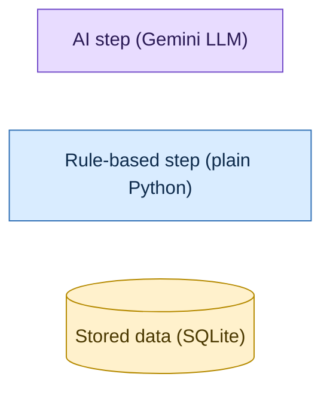
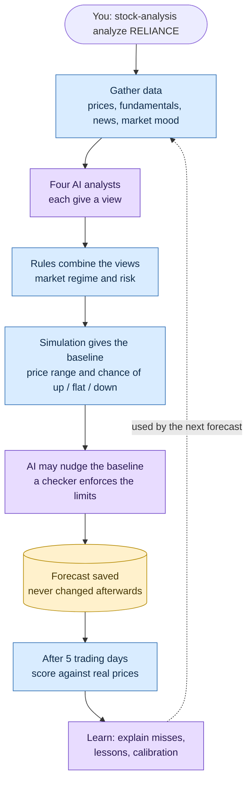
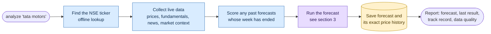
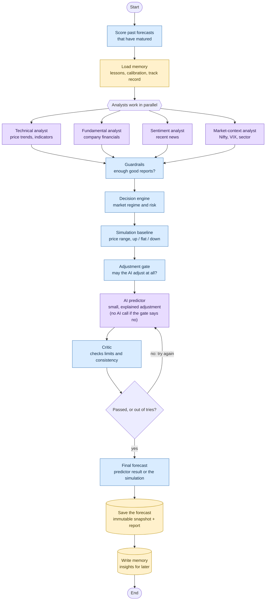
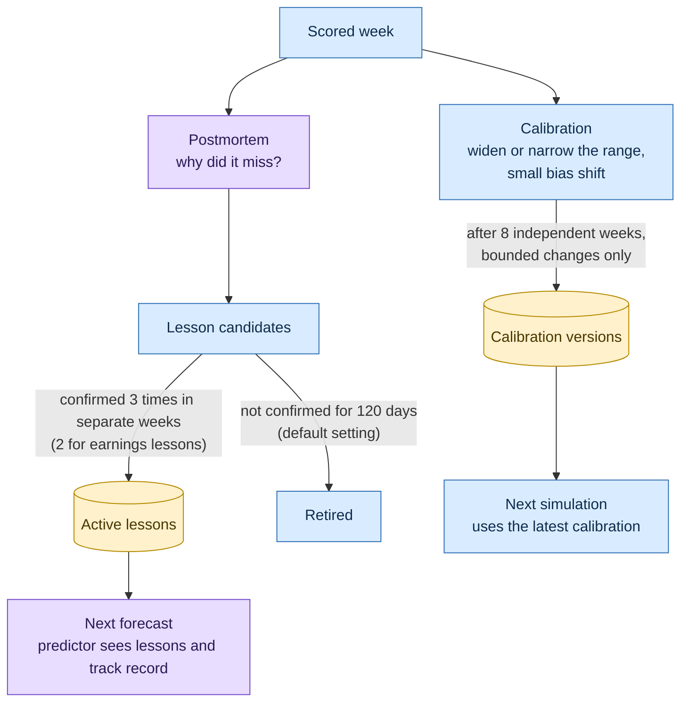
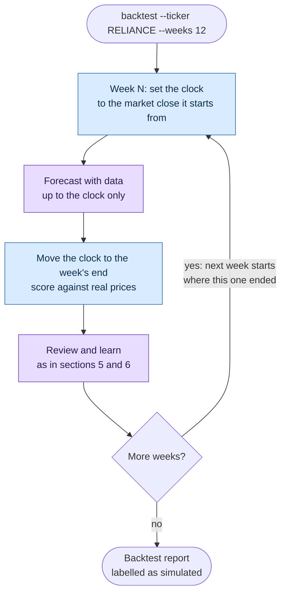
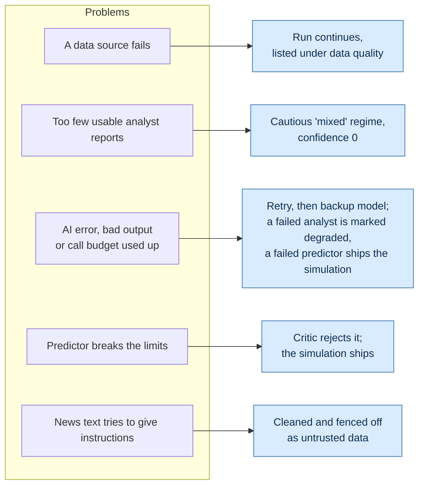
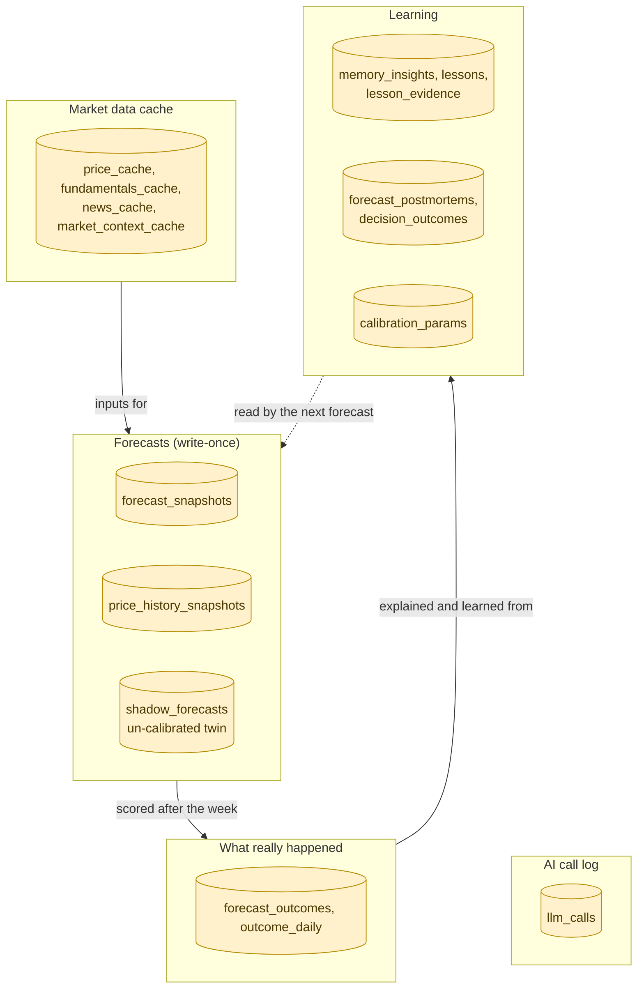

# How the system works — diagrams

This page explains the system with pictures: first the big picture, then one diagram per flow.
You do not need to read the code to follow it. Each diagram ends with a **Where in the code**
line for readers who want to find the implementation.

The output is a probabilistic forecast for research and learning — never buy/sell/hold advice.

The diagrams are written in [Mermaid](https://mermaid.js.org/), which GitHub and most
Markdown previews draw automatically. Each one also has an SVG image version in
[`diagrams/`](diagrams/) for viewers that don't support Mermaid. After changing a diagram here,
regenerate the images with `bash docs/diagrams/render.sh`.

**Colour key used in every diagram**

## Contents

1. [The big picture](#1-the-big-picture)
2. [Making a forecast (`analyze`)](#2-making-a-forecast-analyze)
3. [Inside the forecast: the agents](#3-inside-the-forecast-the-agents)
4. [Who the agents are](#4-who-the-agents-are)
5. [Checking a forecast after the week (`review`)](#5-checking-a-forecast-after-the-week-review)
6. [The learning loop](#6-the-learning-loop)
7. [Replaying the past (`backtest`)](#7-replaying-the-past-backtest)
8. [Safety guards](#8-safety-guards)
9. [Where data is stored](#9-where-data-is-stored)

---

## 1. The big picture

You name an NSE stock. The system gathers data, four AI analysts read it, rules combine their
views, and a simulation produces the baseline forecast for the next 5 trading days. The AI may
nudge that baseline within strict limits, and a checker verifies the result. The forecast is
saved unchanged. After the week ends it is scored against what really happened, and what the
system learns feeds into the next forecast.

Image version: [01-big-picture.svg](diagrams/01-big-picture.svg)

Two rules hold everywhere: **numbers come from code, not from the AI** (the AI only interprets
facts it is given), and **every AI-adjusted forecast is compared with the plain simulation**, so
you can see whether the AI actually helped.

**Where in the code:** `src/stock_analysis/` — `market/` and `data/` (gather), `langgraph/workflow.py`
(forecast graph), `quant/forecast.py` (simulation), `langgraph/review_graph.py` (review),
`learning/` (lessons, calibration).

---

## 2. Making a forecast (`analyze`)

What happens when you run `stock-analysis analyze RELIANCE` (or `"tata motors"`).

Image version: [02-analyze.svg](diagrams/02-analyze.svg)

- A data source that fails is listed under "data quality" instead of stopping the run.
- Today's unfinished trading session is ignored, so the forecast always starts from a completed close.
- `--no-llm` skips every AI step: you get the simulation only.

**Where in the code:** `analysis/` (`run_analysis`, `analysis/inputs.py` `collect_inputs`),
`market/resolver.py` (`resolve_nse_ticker`), `langgraph/runner.py` (`run_forecast`),
`snapshots/report.py` (report).

---

## 3. Inside the forecast: the agents

The forecast itself is a LangGraph workflow. The four analysts run side by side; everything
else runs in order. If the adjustment gate says no, the predictor makes no AI call and passes
the simulation through unchanged. Otherwise the AI predictor and the checker (critic) can go
round a few times; if the predictor still breaks the rules after the allowed tries, the plain
simulation is used instead.

Image version: [03-forecast-agents.svg](diagrams/03-forecast-agents.svg)

**Where in the code:** `langgraph/workflow.py` `build_workflow()`. Nodes in order:
`review_matured` → `memory_loader` → `mark_collectors` → `technical_analyst`,
`fundamental_analyst`, `sentiment_analyst`, `context_analyst` → `guardrails` →
`decision_engine` → `quant_baseline` → `adjustment_gate` → `predictor` → `critic` →
`revision` (routes back to `predictor` via `route_after_revision`, at most `MAX_REVISIONS`) →
`final_forecast` → `join` → `forecast_snapshot` → `memory_writer`.

---

## 4. Who the agents are

| Agent | Reads | Produces | AI or rules |
|---|---|---|---|
| Technical analyst | Indicator summary (trend, momentum, volatility) | A stance (bullish … bearish) with confidence and evidence | AI |
| Fundamental analyst | Valuation and financial ratios | Stance with confidence and evidence | AI (off in backtests) |
| Sentiment analyst | Up to 10 recent headlines, marked as untrusted data | Stance with confidence and evidence | AI (off in backtests) |
| Market-context analyst | Nifty 50, India VIX, sector moves | Stance with confidence and evidence | AI |
| Guardrails | All analyst reports | Pass, or a cautious "mixed" result | Rules |
| Decision engine | Analyst stances | Market regime and risk level | Rules |
| Simulation (quant baseline) | Closing prices | 10th / 50th / 90th percentile price, chance of up / flat / down | Rules (Monte Carlo) |
| Adjustment gate | Regime, risk, guardrail result | Whether the predictor may adjust at all | Rules |
| Predictor | Everything above plus memory | A small adjustment to the baseline, with reasons | AI |
| Critic | The predictor's raw answer | Pass / fail with reasons | Rules |
| Postmortem (after the week) | The forecast and what really happened | Main cause of the miss and up to 3 lessons | AI, checked by rules |

The AI never computes the numbers: analysts choose from a fixed set of stances, and the
predictor can only shift the simulation's probabilities, by at most `PREDICTOR_MAX_PROB_SHIFT`
(default 0.15), which the critic enforces.

**Where in the code:** prompts in `src/stock_analysis/prompts/` (`technical_analyst.txt`,
`fundamental_analyst.txt`, `sentiment_analyst.txt`, `context_analyst.txt`, `postmortem.txt`);
schemas in `schemas/analyst_reports.py` and `schemas/forecast_pipeline.py`; `guardrails.py`;
`learning/postmortem.py`.

---

## 5. Checking a forecast after the week (`review`)

Once a forecast's 5 trading days have passed, the review compares it with real prices. It runs
automatically before every new forecast, and on demand with `stock-analysis review`. If one
step fails, the error is recorded and the remaining steps still run.

```mermaid
flowchart LR
    a["Find forecasts<br/>whose week has ended"]:::rule --> b["Fetch real prices<br/>and score"]:::rule
    b --> c["Explain the result<br/>knowable vs hindsight"]:::ai
    c --> d["Update lessons"]:::rule
    d --> e["Update calibration"]:::rule
    e --> f["Update scorecards"]:::rule
    f --> g["Update track record"]:::rule
    g --> s[("Stored results")]:::data
    classDef ai fill:#e8dcff,stroke:#7048c8,color:#2a1a55
    classDef rule fill:#d9ecff,stroke:#2f6fb5,color:#0f2c4d
    classDef data fill:#fff1cc,stroke:#b58a00,color:#4a3800
```

Image version: [04-review.svg](diagrams/04-review.svg)

- Scores used: Brier score for up / flat / down, pinball loss for the price range, and whether
  the real price landed inside the 80% range.
- Ordinary noise (the price stayed inside the expected range) is not sent to the AI and never
  creates a lesson.

**Where in the code:** `langgraph/review_graph.py` (`REVIEW_STEPS`: `find_matured` → `score` →
`postmortem` → `learning` → `calibration` → `scorecards` → `track_record`), `review/`
(`OutcomeReviewer`, `outcome_scorer.py`), `learning/` (`LearningCycle`).

---

## 6. The learning loop

How a scored week changes future forecasts. Changes are small, need repeated evidence, and are
recorded with their reasons, so they can always be audited. The un-adjusted simulation is kept
next to every calibrated one, so the system can tell whether calibration helps.

Image version: [05-learning-loop.svg](diagrams/05-learning-loop.svg)

**Where in the code:** `learning/lessons.py`, `learning/calibration.py`,
`learning/context.py` (`add_learning_context`, used by `memory_loader`),
`database/memory_store.py`, `database/learning_store.py`.

---

## 7. Replaying the past (`backtest`)

A backtest replays past weeks one at a time, as if the system were running live on each date.
A simulated clock makes sure each forecast only sees data available on that day; trying to read
a later price raises an error. Fundamentals and news cannot be rebuilt for past dates, so those
two analysts are switched off.

Image version: [06-backtest.svg](diagrams/06-backtest.svg)

Backtest forecasts are stored with the source "backtest" and reported separately from live
ones, because an AI model may already know what happened on those past dates.

**Where in the code:** `backtest/` (`run_backtest`, `HistoricalMarketData.as_of`,
`PointInTimeView`, `HistoricalPriceSource`, `LookaheadError`).

---

## 8. Safety guards

The system prefers a cautious answer to no answer. Each failure has a defined fallback.

Image version: [07-safety-guards.svg](diagrams/07-safety-guards.svg)

**Where in the code:** `reliability.py` (retries, rate limits), `untrusted.py` (news
sanitising), `guardrails.py`, `llm/factory.py` (backup model, repair re-prompt),
`llm/usage.py` (call budget and cost).

---

## 9. Where data is stored

Everything lives in one SQLite database (`DATABASE_PATH`). Forecasts are write-once: they can
be corrected only by adding a new version, and scoring always uses the original.

Image version: [08-storage.svg](diagrams/08-storage.svg)

**Where in the code:** `database/` (`forecast_store.py`, `memory_store.py`,
`learning_store.py`, `llm_call_store.py`), migrations in `alembic/versions/`. Settings, logs and
troubleshooting: [operations.md](operations.md).
